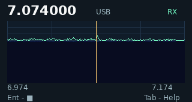
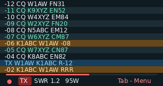
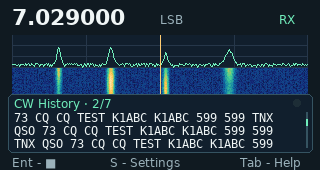
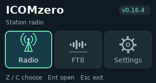
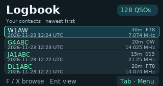

<div align="center">


# ICOMzero

**Your radio, on your Cardputer or uConsole.**

Direct network listening · Live waterfall · CW decoding · FT8 contacts & logging

[](https://github.com/unagisan69/ICOMzero/releases/latest)
[](#install)
[](#install)
[](LICENSE)

[uConsole guide](docs/UCONSOLE.md) · [简体中文设置教程](docs/SETUP.zh-CN.md) · [Install](#install) · [Features](#features) · [Controls](#controls) · [Supported radios](#supported-radios) · [User guide](docs/USER_GUIDE.md) · [Changelog](CHANGELOG.md)

</div>

ICOMzero connects a **Cardputer Zero running the stock M5Stack Debian image** or a **uConsole running ARM64 Debian** directly to a supported Icom or Kenwood network radio. Listen, tune, read CW, or work FT8 from the handheld—without a computer bridge.

| Radio & waterfall | FT8 contacts |
| :---: | :---: |
|  |  |
| **CW decoding & scrollback** | **Radio, FT8, Log & Settings** |
|  |  |

*Interface examples use demonstration data.*

## Install

### From the Cardputer App Store

1. Connect your Cardputer Zero to Wi-Fi and open **App Store**.
2. Search for **ICOMzero**, or use share code **`ICMZ`**.
3. Install, then open **ICOMzero** from APPLaunch.

### On uConsole

Download the **desktop ARM64 package** from [GitHub Releases](https://github.com/unagisan69/ICOMzero/releases/latest), then install it on the uConsole:

```sh
sudo apt install ./icomzero-desktop_0.18.0-1_arm64.deb
```

Open **ICOMzero** from the desktop menu. The native desktop interface has crisp system fonts, a full-width spectrum/waterfall, and persistent **Radio · FT8 · Log · Settings** tabs. View or sync Log and browse Settings while Radio or FT8 continues. Switching Radio ↔ FT8 hands off the radio connection. **Ctrl+1–4** selects tabs and **Ctrl+Space** stops TX from any tab. The resizable window is keyboard-first: **↑/↓ navigate**, **←/→ tune**, **Ctrl+↑/↓ zoom**, **Ctrl+←/→ volume**, **Ctrl+M mute**. Trackball navigation is optional. **Ctrl+Enter** toggles fullscreen; **Ctrl+Q** quits safely. Profiles and logs use the same private format as Cardputer.

[Installation, full controls and migration →](docs/UCONSOLE.md)

### Updates

Use **Settings → Check for updates** for the latest stable GitHub release. The app shows download progress, verifies the package checksum, and preserves settings and QSO history. Startup update checks are optional and run in the background.

For manual installation, download the ARM64 package from [GitHub Releases](https://github.com/unagisan69/ICOMzero/releases/latest). Close ICOMzero before installing:

```sh
sudo apt install ./icomzero_0.18.0-1_arm64.deb
```

After an update, fully close and reopen the app to load the new version. [Update details →](docs/USER_GUIDE.md#app-settings-and-updates)

## Quick start

1. **Add your radio.** Open **Settings → Radios**, add or edit a named profile, then choose **Use this radio**. Enter its host, ports and network account. Your Cardputer must be able to reach the radio's control and audio ports.
2. **Start listening.** Choose **Radio**, press **Enter**, and use **Z/C** to tune. **B** chooses a band; **S** opens radio-specific settings.
3. **Choose your activity.** Press **W** for receive-only CW decoding, or return to the main menu and choose **FT8**. Set your callsign, grid and logging preferences in the FT8 menu before transmitting.

**FT8 can automatically run the antenna tuner after band selection, briefly transmitting a carrier.** Opening CW decoding does not transmit or change your tuning.

[Connection setup and port defaults →](docs/USER_GUIDE.md#listen) · [FT8 setup and operation →](docs/USER_GUIDE.md#ft8-contacts)

## Features

### 📻 Radio listening & tuning

- **Direct network audio** through the Cardputer speaker, with saved volume and mute.
- **Live spectrum and waterfall**, with **1× / 2× / 4× / 8× zoom** centered on the tuned frequency. Use **Fn+F / Fn+X** to zoom in/out; 1× keeps the original full view.
- **Hold-to-tune controls**, band presets and per-radio **1000 / 500 / 100 Hz** steps.
- **USB, LSB, CW and CW-R** mode selection; band presets preserve native CW modes.
- **Noise reduction** toggle and **antenna-tuner control** on models that support them.
- Bounded reconnection and clear connection diagnostics when a stream is interrupted.

[Radio controls and connection guide →](docs/USER_GUIDE.md#listen)

### 〰️ CW receive decoder

- Turn decoding on with **W** while keeping the radio's mode, frequency and filter unchanged.
- **Automatic or manual tone selection**, detected pitch and estimated character speed.
- Timing that adapts to **uneven sending and stretched letter spacing**.
- **F/X scrollback** with hold repeat, a reading-position indicator and a scrollbar.
- New decodes stay in view when following live; browsing stays put until you scroll back to the bottom.
- **16,384 characters of in-memory history per Radio session**. Retuning, reconnecting and resynchronizing start a new line instead of wiping the window.
- Decoder audio is independent of speaker volume and mute. Late audio bursts do not reset Morse timing merely because delivery was delayed.

CW is receive-only. Crowded signals, fading, digital modes and irregular sending can still produce errors; tune a clear signal and choose its audio tone when needed.

[CW setup, scrollback and limitations →](docs/USER_GUIDE.md#cw-receive-decoder)

### 📡 FT8 reception & contacts

- **Silent FT8 reception** with compact, alternating-color decode rows and signal reports.
- Focused display of **CQ calls, conversations involving you and your own completed TX frames**.
- Callsign highlighting, **green POTA/SOTA CQ rows**, and scrollable message selection.
- **Enter to reply or continue an exchange** from the selected station's latest relevant message.
- Automatic transmit audio offset and **opposite-period replies**; manual offset and CQ-period settings are also available.
- Standard grid/report exchanges, **RRR acknowledgment**, terminal 73 and completed-contact logging.
- Configurable nominal TX power and audio level; live **TX, SWR and measured power** indicators, armed dot and a red TX progress bar.
- Band selection before setup when the radio is not already on a designated FT8 frequency.
- Synchronized-clock checks and stop conditions for RF, telemetry, PTT, connection or timing faults.

Measured RF output can differ from the power setting. Network-polled SWR/ALC protection supplements the radio's own protection; it cannot guarantee instantaneous cutoff during a disconnect. IC-7300MK2 is the physically validated FT8 platform.

[FT8 operation →](docs/USER_GUIDE.md#ft8-contacts) · [Clock and RF protection →](docs/USER_GUIDE.md#clock-and-rf-protection)

### 📖 Onboard logbook

- Open **Log** from the main menu to browse all onboard contacts, newest first, and search by callsign.
- View each contact’s UTC time, band/mode, frequency, reports and Wavelog/QRZ upload status.
- **New entry** records a contact without connecting to a radio. Choose FT8, FT4, SSB, CW, AM, FM, RTTY or PSK31; enter its date/time, frequency, reports and optional grid/notes.
- **Sync logs** downloads full contacts from Wavelog or QRZ, matches existing contacts and queues missing onboard entries for upload to the selected service. Sync is incremental and preserves existing records.
- Configure shared identity and API accounts in **Settings → Station & logging**, or from the Log menu. Credentials remain on your device.



[Logbook and synchronization details →](docs/USER_GUIDE.md#onboard-logbook)

### 🔁 Auto CQ & POTA Hunt

**Auto CQ is the first item in the FT8 menu**, above Bands.

| Mode | Behavior |
| --- | --- |
| **Auto CQ** | Send one own CQ, then try up to five eligible strong recent CQ stations twice each if unanswered. Advancing exchanges allow four unanswered attempts per stage. |
| **Caller queue** | Queue stations answering during another exchange, then give fresh queued callers priority after the current contact. |
| **POTA Hunt** | Monitor POTA/SOTA CQs, reply with a direct R-report, allow three unanswered attempts per stage, then rest and resume monitoring. |
| **Session journals** | Keep private timestamped decodes, frequencies, decisions, queue events, TX outcomes and stop reasons for later review. |

Automation starts only when you explicitly select it. Stop Transmit, exit, relevant setting/band changes and faults stop it; a fault does not automatically restart a session.

[Auto CQ and queue rules →](docs/USER_GUIDE.md#auto-cq) · [POTA Hunt →](docs/USER_GUIDE.md#pota-hunt)

### 📒 Logging, worked history & station labels

- **Local SQLite log with ADIF data**, saved before remote uploads.
- Independent **Wavelog and QRZ** uploads, with pending-upload retries and connection tests.
- **Record QSO** for a manually reviewed contact when a terminal acknowledgment was missed.
- **Sync Log** imports worked history from either service.
- **Hide previous contacts** filters FT8 contacts on the **current band only**. Auto CQ still answers or queues previously worked stations addressing you.
- Offline country/territory estimates and **USA-XX state labels** from registered callsign data. These describe callsign entities or registered addresses, not live portable locations.
- A green saved-QSO notification and optional QSO beep; a separate beep signals Auto CQ ending without responses.

QRZ API access may require a subscription. A local save notification does not mean that remote uploads have finished.

[Logging and synchronization →](docs/USER_GUIDE.md#logging) · [Country/state data →](docs/USER_GUIDE.md#countries-and-us-states)

### ⚙️ Profiles, updates & privacy

- **Name, edit, clone and select multiple radios** from the main Settings menu.
- Connection details and tuning step per profile; volume/mute and logging preferences shared across the app.
- Optional background version checks, manual updates, download progress and **SHA-256 verification**.
- On-screen shortcut guides, centered notices, and **Enter to request RF-warning clearance**.
- Credentials and diagnostic/session logs are stored privately on the device. Contacts upload only to logging services you enable; no personal station defaults or API keys are bundled in the public app.

[Settings and updates →](docs/USER_GUIDE.md#app-settings-and-updates)

## Controls

### Radio & CW

| Key | Action |
| --- | --- |
| **Enter** | Start / stop listening |
| **Z / C** | Tune down / up; hold to repeat |
| **B** | Choose band |
| **S** | Radio settings: band, step, mode, CW decoder and tone |
| **M** | Toggle USB / LSB |
| **W** | Toggle CW decoding |
| **F / X** | Scroll CW history up / down; bottom resumes live following |
| **Fn+F / Fn+X** | Zoom spectrum/waterfall in / out (1×–8×) |
| **Fn+S / Fn+D** | Volume down / up |
| **Fn+A** | Mute / unmute |
| **N** | Toggle noise reduction, where supported |
| **T** | Start antenna tuner, where supported; **briefly transmits** |
| **Tab** | Shortcut guide |
| **Esc** | Return to main menu |

### FT8

| Key | Action |
| --- | --- |
| **F / X** or **Fn+F / Fn+X** | Select/scroll decodes; bottom clears selection and follows newest |
| **Enter** | Reply / continue selected contact, or request clearance of a displayed warning |
| **Tab** | Bands, CQ/automation, station settings, logging, tuner and help |
| **Esc** | Stop transmission and return to main menu |

In text fields, **Enter** edits/saves, **Esc** cancels/returns, **Backspace** erases and **Del** clears. On the stock keyboard, **SYM+B** enters a period.

## Supported radios

| Manufacturer | Direct network profiles |
| --- | --- |
| **Icom** | IC-705 · **IC-7300MK2** · IC-7610 · IC-7760 · IC-7850 / IC-7851 · IC-905 · IC-9700 · IC-R8600 |
| **Kenwood** | TS-890S using native KNS |

**IC-7300MK2 is tested on physical hardware. Other profiles have protocol/emulator coverage and await physical-radio validation.** IC-R8600 is receive-only; other controls depend on each radio's capabilities.

The original IC-7300 and USB/serial-only wfview radios need a computer bridge and are outside this direct-network release. IC-7850/7851 use the shared IC-785x profile.

## Guides & project

- [Complete user guide](docs/USER_GUIDE.md) — setup, operating details, automation, logging, protection and diagnostics.
- [Build and test](docs/USER_GUIDE.md#build-and-test) — source builds, AppBuilder packaging and SSH diagnostics.
- [Changelog](CHANGELOG.md) — release history and fixes.
- [Releases](https://github.com/unagisan69/ICOMzero/releases) — ARM64 packages and checksums.
- [Report an issue](https://github.com/unagisan69/ICOMzero/issues) — include app version, radio model and error text; remove credentials from attachments.

Built with reference to [wfview](https://github.com/wf-group/wfview), [ft8_lib](https://github.com/kgoba/ft8_lib) and [CardputerZero AppBuilder](https://github.com/CardputerZero/AppBuilder). The updater is adapted from [MeshCore Zero](https://github.com/unagisan69/meshcore-zero). See the [guide credits](docs/USER_GUIDE.md#credits) and bundled notices for attribution.

**License:** [GNU GPL v3](LICENSE).
