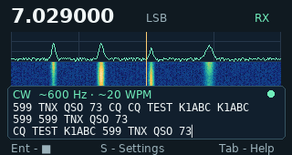
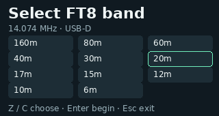
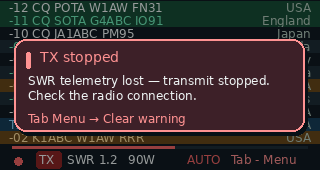

# ICOMzero

Listen to a network-connected radio on a **Cardputer Zero** running the stock M5Stack Debian image. ICOMzero connects directly to the radio over LAN or Wi-Fi and plays receive audio through the Cardputer speaker, with a live spectrum/waterfall, tuning, band presets, noise reduction, and antenna-tuner controls where the radio supports them.

## Direct network radios

| Manufacturer | Models |
| --- | --- |
| Icom | IC-705, IC-7300MK2, IC-7610, IC-7760, IC-7850 / IC-7851, IC-905, IC-9700, IC-R8600 |
| Kenwood | TS-890S |

These profiles use the native network protocols and capabilities from wfview's radio definitions. **IC-7300MK2 has been tested on physical hardware. The added models have protocol and emulator coverage and still need physical-radio validation.**

The IC-7300 original model and the USB/serial-only wfview radios require a computer bridge and are outside this direct-network release. The IC-7850/7851 share the **IC-785x** profile.


## Install

Install **ICOMzero** from the **App Store** on your Cardputer Zero.

1. Open **App Store** from the launcher.
2. Find **ICOMzero**, or enter the share code **ICMZ**.
3. Select **Install**, then open **ICOMzero** from APPLaunch.

Connect the Cardputer to a network that can reach the radio and enable the radio's network control with a configured user account.

For manual installation, download the `.deb` from [GitHub Releases](https://github.com/unagisan69/ICOMzero/releases), then install it on the Cardputer.

```sh
sudo apt install ./icomzero_0.16.2-1_arm64.deb
```

Open **ICOMzero** from APPLaunch after installation.

Version 0.16.2 includes the hardware-validated IC-7300MK2 FT8 reliability updates: continuous 12 kHz audio, a 300 ms transmit buffer with matching PTT drain, complete packet-loss repair, and bounded control recovery. The FT8 status bar keeps the armed dot and TX/SWR/power indicators without AUTO or POTA text labels. Successful contacts are saved locally and uploaded independently to enabled logging services. Radio listening remains at 48 kHz. Compare the radio’s own power/SWR/ALC meters with the app; nominal power is a control setting, not a guarantee of measured RF output.

## Listen

1. Open **Settings → Radios** from the startup menu. Choose a named radio, then **Edit connection**, or add/clone a profile. Use **Use this radio** to select the connection used by both Radio and FT8. Legacy connection settings migrate automatically and credentials stay private on the device.
2. Enter the radio's name, IPv4 address or hostname, ports, username and password. **F/X** or arrows select fields; **Enter** opens a text field or model/login picker. Enter saves an edited field; Esc cancels that edit or returns to the previous screen. Backspace erases and **Del** clears a text field. **SYM+B** enters a dot. **Auto (Icom)** identifies a supported Icom from its name or CI-V address; choose an exact model for a custom radio name/address.
   - Icom uses control port **50001** by default. Keep its normal negotiated audio ports.
   - TS-890S uses **60000** for TCP control and **60001** for UDP audio. Selecting TS-890S switches the default control port. Set **Login** to **User** or **Admin** to match the account configured on the radio. Its 16 kHz LPCM audio is converted to the app's 48 kHz speaker stream.
3. Choose **Radio**, then press **Enter** to start or stop listening. **Z** and **C** tune down and up at the saved tuning step. Hold either key to scroll. Press **B** for band presets, select with **Z** or **C**, then press **Enter** to tune to the displayed frequency. The menu shows presets within the connected model’s frequency ranges. Voice band presets select LSB on 160/80/40 m and USB on the remaining presets. CW/CW-R uses CW receive presets and preserves the current CW mode.
4. Use **Fn+S** to lower the volume and **Fn+D** to raise it. Hold Fn while pressing S or D repeatedly. **Fn+A** toggles mute. The volume appears briefly as you adjust it, and volume and mute are saved for the next launch.
5. **N** toggles the radio’s noise reduction where supported. **T** starts its antenna tuner, which briefly transmits a tuning carrier. T is inactive on receiver-only radios and models without a tuner command. The top line shows the current mode, NR when enabled, and TUNING during a tuner operation. Press **M** to switch USB/LSB. Press **Esc** to return to the main menu.

The waterfall uses the radio’s scope span and center or fixed-range settings. Icom radios negotiate secondary UDP ports. Kenwood audio arrives on the configured UDP audio port. Keep the radio and Cardputer on the same LAN. Temporarily refused/zero-port stream replies trigger fresh stream transactions with bounded backoff, using the existing login. Login, secondary-channel setup and CI-V startup have separate time budgets. Address-change and other socket errors enter the bounded reconnect path, including Wi-Fi roaming/DHCP changes. A recovered session requests RX, retains any latched RF fault, and does not restart FT8 transmission or an automatic tuner carrier. FT8 revalidates the entry band after reconnecting. Peer-closed control, CAT and audio channels retain their channel-specific reason instead of a generic Disconnected message. Connection failures retain their underlying reason on screen and in a bounded private `~/.config/icomzero/connection-diagnostics.jsonl` file (no credentials or packet payloads). If the radio is busy, disconnect the other LAN client and try again. Settings are saved in `~/.config/icomzero/radio.json` (or under `$XDG_CONFIG_HOME`) with user-only permissions. The password is stored in that file as text and encoded using Icom's LAN protocol on the wire.

Press **S** on the receiver screen for **Band**, **Tuning step**, and **Mode** (LSB / USB / CW / CW-R). Enter on Tuning step cycles **1000, 500 and 100 Hz**; the choice is saved per radio and applies to tap/hold tuning. Reception continues while this menu is open. Connection settings now live in the main **Settings → Radios** menu.

Press **Tab** on the receiver screen to open the keyboard shortcut guide. **Tab** or **Esc** closes it.

## CW receive decoder

While listening in **Radio**, press **W** to turn CW decoding on or off. **This leaves the radio’s receive mode, frequency and filter unchanged.** Keep LSB or USB selected if that is where the CW sounds clear. **S → CW decoder** offers the same toggle. Native **CW/CW-R** remain available under **S → Mode**, but changing demodulation modes can move the receive passband and require retuning to the station. Selecting a native CW mode also enables decoding.

The panel beneath the waterfall shows the newest decoded text, detected tone and estimated character speed. A green dot follows the received tone. Audio is decoded before speaker volume/mute processing, so Fn+A can silence the speaker without stopping decoding. **S → CW tone** selects Auto or a specific audio pitch when several signals are audible; tone selection affects only the decoder. A 100 Hz tuning step helps center a station. Decoding does not key the radio, send Morse, reply or log CW contacts. Changing frequency/mode or reconnecting resets partial characters; missing audio triggers resynchronization.

The automatic detector searches roughly **200–2800 Hz** and checks tone concentration locally rather than requiring one signal to dominate the entire passband. It uses [standard Morse timing](https://www.arrl.org/files/file/Technology/x9004008.pdf) and was tested with generated noisy audio at **8–35 WPM**. Tune a clear CW signal and select its tone if needed. Mixed stations, RTTY/digital signals, QRM, deep fading and irregular hand spacing can cause errors; unknown symbols appear as question marks. Speed estimates describe character timing, not overall QSO rate.




## App settings and updates

The startup menu has **Radio**, **FT8** and **Settings** icon cards. The active radio name and installed version appear above them. Exit Radio/FT8 before changing the active connection in **Settings → Radios**. Names may be up to 32 characters; cloned profiles copy connection details and tuning step, then can be edited independently. Volume/mute and FT8 logging preferences remain app-wide.

**Settings → Check for updates** checks stable releases from this GitHub repository. Launch checks run in the background with a seven-second limit; offline checks do not block the menu or interrupt a radio session. **Launch update check** can be turned off. When an update is available, choose View update and Download. The app shows transferred bytes and a progress bar, verifies SHA-256, then asks for the **device administrator password** to install. This is separate from radio/API credentials and is never saved. Installation validates package name, version and ARM64 architecture, refuses downgrades, and reports APT installation progress. Download can be cancelled; an installation already in progress is allowed to finish. Choose Restart after completion. Settings and QSO history are preserved. Private bounded timing logs contain stages/durations only; root installation output goes to `/var/log/icomzero-update.log`.

The updater is adapted from [MeshCore Zero](https://github.com/unagisan69/meshcore-zero); its MIT notice is included in `docs/meshcore-updater-LICENSE`. Release maintainers must upload `icomzero_VERSION-1_arm64.deb` and **SHA256SUMS** together for a stable `vVERSION` release. SHA256SUMS names the package file without a path. The updater accepts only matching release assets from this repository over HTTPS.

## FT8 contacts

Choose **FT8** from the startup menu. Reception starts silently on the radio’s current **designated FT8 dial frequency**, preserving 20m at 14.074 MHz when already selected. If the radio is elsewhere, a required band chooser appears before receive setup, automatic tuning or TX; Tab cannot bypass it and Esc exits. Band selection explicitly tunes the designated dial. The active band is shown beside RF power and in the FT8 menu title. The screen displays eleven smaller decode lines, prefixed with estimated signal reports in dB relative to 2500 Hz. Only CQ calls, messages involving your configured callsign, and your own transmitted frames appear. Blue **TX** rows appear after the transmitted 15-second period ends and are local transmit records, not received decodes or proof the other station heard you. Gold rows indicate your callsign; the outlined row is your selection.

- **F / Fn+F** selects the previous decode; **X / Fn+X** selects the next. Hold to move through history one line at a time. Selection stays on the same decode when new messages arrive. Scrolling down to the newest line clears selection and resumes automatic scrolling.
- **Enter** replies to or continues the highlighted recent contact. Selection clears after replying and the display returns to the newest decodes.
- **Tab – Menu** opens Bands, Call CQ, Auto CQ, POTA Hunt, Settings, Stop Transmit, Logging, Record QSO, Tune antenna and Help. With a decode highlighted, Call CQ is displayed as **Reply / continue** and uses that station’s latest relevant message.
- **Esc** returns to the main menu and stops transmission.

In **Settings**, enter your callsign and Maidenhead grid (four or six characters), choose your CQ period, TX audio frequency, audio level (10–80%, default 50%), and nominal RF power in watts (default 10 W; TS-890S minimum 5 W). **TX audio Hz defaults to Auto**: replies use the selected station’s decoded audio offset (200–2800 Hz) and lock it for the contact. Auto uses 1500 Hz for your own unanswered CQ and adopts the first responder’s offset. Enter a numeric value to keep a fixed offset; existing saved numeric settings remain manual. Adjust transmit audio for little/no ALC using the radio’s meter. **Call CQ** without a selection starts your own CQ. Replies resume from the latest relevant stage: CQ → grid, grid → report, report → R-report, R-report → RRR, acknowledgment → 73. Known exchanged reports are retained when resuming. An unknown prior report is not invented for logging. Replies derive their opposite even/odd UTC period from the selected station, independently of your own CQ-period setting. On IC-7300MK2, receive setup selects **USB-D / FIL1**, clears split/RIT/XIT and turns NR off after retaining their prior settings. TX preparation selects **DATA MOD = LAN** (not the separate voice DATA OFF input) and requires readback of data mode, filter, LAN source and disabled offsets before keying. These command mappings follow the [Icom CI-V reference](https://icomuk.co.uk/files/icom/PDF/productAdditionalFile/IC-7300MK2_ENG_CI-V_0.pdf). Prior settings are restored on a reachable, confirmed-RX normal exit. A standard contact exchanges grids and signal reports, uses **RRR** (not RR73) for acknowledgment, and finishes with 73. Incoming RR73 is accepted. Ordinary Call CQ/reply retains a five-repetition or three-minute limit. Only one contact is active at a time.

**Auto CQ**, directly under Call CQ, explicitly starts an automatic session. It sends **one own CQ**, allowing the final receive period to decode. If nobody answers, it selects the strongest eligible CQ heard within **90 seconds** (newest decode wins an SNR tie), calls that station **twice**, then tries up to **four different fresh CQ stations twice each** (five targets total). It ends if all five go unanswered or no fresh eligible target remains. Target calls use the decoded audio offset and opposite UTC period. An advancing reply starts the normal exchange, with four unanswered attempts per contact stage. Stalled exchanges are abandoned without logging; completed contacts save through the normal local/Wavelog/QRZ path.

Stations addressing you during another contact enter a **FIFO caller queue**. Repeated calls refresh the same entry; up to 16 callers are retained, and messages older than 120 seconds expire. After a successful or stalled contact, fresh queued callers get priority over a new CQ round. Without queued callers, a fresh one-CQ round begins. The session skips already completed stations, and a fallback round never calls the same target twice. CQ candidates are removed when a later decode shows them conversing with another station. Automatic targeting accepts standard FT8 calls (including /P and /R); other compound/hashed calls remain visible but are skipped because their replies cannot currently be resolved reliably across decode periods. The footer retains the armed dot without an AUTO label, and **Stop Auto CQ** shows the queued count when nonzero. Stop Transmit, exit, band/settings changes and any RF, clock, connection, encoder or PTT fault stop the session; faults never restart it. Auto CQ is never armed on startup.

**POTA Hunt**, directly below Auto CQ, stays in receive-only monitoring until it hears an eligible **CQ POTA** or **CQ SOTA**. It does not transmit its own CQ or a grid-first call: its first reply is the requested **R±dB** report using the decoded SNR, e.g. `W1AW K1ABC R-12`. It follows the activator’s audio offset and opposite UTC period. Each stage gets three unanswered transmission attempts; an advancing report resets the counter. After completion or exhaustion it rests for 15 seconds, then monitors again; a failed activator has a 60-second cooldown. Already completed stations are skipped for the session. The footer keeps the armed dot without a POTA label, and the menu changes to **Stop POTA Hunt**. Stop Transmit, exit, band/settings changes and RF/clock/connection faults stop monitoring as well as TX. Session journals include the mode, rest and target decisions.

POTA Hunt’s direct R-report start still requires a real report from the other station before a QSO can be logged. An early RRR/RR73 without that report is not treated as a completed contact; reports are never invented. Actual report replies advance through the existing RRR/73 logic and local/Wavelog/QRZ logging.

Newly saved QSOs play a short rising speaker beep; disable it with **Settings → QSO beep**. Auto CQ ending after its own-CQ/target search finds no responses plays a distinct descending beep. Notifications wait for confirmed receive state, and FT8 receive audio stays muted.

Auto CQ keeps private, timestamped JSONL journals in **`~/.config/icomzero/auto-cq/`** (or under `$XDG_CONFIG_HOME`). Each session records UTC timestamps, slot numbers, dial/audio frequencies, all new received decodes and their SNR, transmitted text and outcomes, retry counters, caller queue additions/refreshes/expiry, fallback selections and rankings, country estimates, contact transitions, local QSO saves, meter/clock snapshots, logging status and stop reasons. Files rotate into numbered parts at 8 MiB without deleting earlier parts. Directory permissions are 700 and files 600; API keys and connection credentials are excluded. Logs remain on your device and are not uploaded with the app. Stop Auto CQ before copying its session files for review.

CQ messages containing a separate **POTA** or **SOTA** tag have a green background. US decode rows show **USA-XX**, using exact registered states from the [FCC public Amateur license snapshot](https://data.fcc.gov/download/pub/uls/complete/l_amat.zip) dated 2026-11-15. The bundled lookup contains 821,787 callsign/state pairs, without names, street addresses, ZIP codes, emails or phone numbers. These are registered license states, not verified current portable/POTA/SOTA locations; missing mainland states show **USA-??**, never a guess from the call-area digit. Foreign operating prefixes retain their foreign entity. A custom compact lookup may be installed as `~/.config/icomzero/us-states.sqlite3`; see `vendor/us-states/README.md` and `tools/build_us_states.py`. Decode rows show a compact country/territory label when there is room; the selected-decode menu shows the full entity before the message text. Lookup runs offline using [BIG CTY by AD1C](https://www.country-files.com/big-cty/), pinned to the MIT-licensed 15 September 2026 [Debian source snapshot](https://deb.debian.org/debian/pool/main/h/hamradio-files/hamradio-files_20260915.tar.xz). Exact callsign exceptions and longest prefixes distinguish entities such as Hawaii and the Canary Islands; portable operating prefixes are supported. This is a likely callsign entity, not a verified live station position. Hashed/unmapped calls show Unknown; maritime/aeronautical mobile are marked explicitly. To import a replacement CTY.DAT, copy it to `~/.config/icomzero/cty.dat` and restart the app. Invalid files fall back to the bundled database. Attribution and license are in `vendor/country-files/` and the installed copyright documentation.

Warnings and temporary notices use centered, wrapped pop-up cards. RF warnings stay latched until cleared with Enter; the new presentation does not weaken their safety behavior.





The device must report NTP synchronization before transmission. The menu shows clock health; a reported offset over 250 ms blocks TX. Clock checks repeat during a sequence, and clock jumps, pacing stalls, failed PTT confirmation, disconnects, band changes and Stop Transmit cancel transmission. Waveforms are prepared before the slot. PTT is requested up to 500 ms before the fixed audio start at UTC slot +0.5 seconds; frames are queued only in the first 200 ms of their chosen slot. Audio waits for confirmed TX. PTT readbacks must match the requested state, and a pending state is queried every 50 ms. PTT-off confirmation is required before a transmission counts as completed. Split, RIT and XIT are disabled and read back before TX so the intended VFO frequency is used; their previous settings are restored on a normal exit. RF power is applied and read back before tuning or FT8 TX. Icom power settings use a nominal fraction of the model’s rated power; actual watts depend on band and hardware limits. The live RF meter reports calibrated output, and the prior power control is restored on normal exit. Receive-only IC-R8600 cannot transmit. Network transmit paths cover the supported Icom models and TS-890S; physical validation is on IC-7300MK2, and other transmit models still need hardware validation.

**Automatic antenna tuning briefly transmits a carrier** after the entry band is confirmed and after each explicit band change, on models with a supported tuner. It waits for band and power confirmation; Call CQ/reply waits for tuning to finish. Stop Transmit cancels active tuning but preserves an already completed tuner match. Opening Settings also preserves that match. The main menu no longer displays the tagline.

The footer distinguishes a **red dot** (contact/CQ sequence enabled, including receive periods) from red **TX** (radio transmitting, including tuner carriers). Beside TX are fresh SWR and actual watts; receive periods show the configured wattage. The period progress bar turns red during TX and continues from the UTC clock even when receive audio pauses. The watt readout is a rounded, median/EMA-filtered estimate from the pinned wfview meter calibration. Raw SWR/ALC protection remains unfiltered. Samples older than 1.2 seconds are hidden. Private `rf-power.jsonl` summaries retain unsmoothed steady-frame minimum/median/maximum power, excluding key-up/key-down edges, so reported variations remain available for diagnosis. These are radio-meter readings, not independent RF measurements.

**RF protection:** SWR strictly above 2.0 stops FT8 audio and requests PTT-off/tuner-stop, with a latched warning. ALC at the model’s redline, or above 20% of that redline for 0.3 seconds, also stops FT8; reduce TX audio level before restarting. FT8 meter queries are staggered at 100 ms intervals, reading each meter every 500 ms. Missing SWR/ALC telemetry after a two-second startup/staleness limit stops FT8 transmission. Confirmed RX ends that RF episode’s meter-age timer; the following transmission starts a new timer when PTT-on is sent. Receive intervals and a pending unsent PTT request do not reuse the preceding frame’s telemetry deadline. Internal tuner cycles have a three-second SWR telemetry startup/staleness limit to accommodate tuning pauses; a fresh SWR above 2.0 still stops immediately. The radio’s internal tuner carrier uses the SWR guard but is exempt from external-audio ALC checks. Consequently automatic tuning can abort when the initial match exceeds 2.0. Correct the cause, then press **Enter** on the warning to request clearance and explicitly restart tuning or the contact. Enter cannot also start a reply while a warning is present. The old Tab → Clear warning menu item is removed. Clearing waits for fresh receive/tuner readback and does not restart transmission. RF faults write bounded, private meter-age diagnostics to `~/.config/icomzero/rf-diagnostics.jsonl`; credentials and decoded traffic are excluded. These network-polled guards supplement the radio’s own protection and cannot guarantee instantaneous RF cutoff if connectivity fails.

Unused network spectrum output is disabled during FT8 and restored on exit, leaving the radio’s own scope display untouched. Speaker audio stays disabled in FT8. Raw audio reaches a bounded capture worker before volume/mute processing. The network thread only enqueues PCM with its arrival timestamp; filtering and decoder locks cannot block its audio pacing and meter service. Capture overruns discard queued backlog and reset alignment instead of joining discontinuous samples. Packet drains also yield after a three-millisecond work budget, and private diagnostics record transport-loop gaps over 80 ms. Unchanged decode rows are cached while TX progress and meters continue to redraw. Reception stays aligned to 15-second periods. An early decode pass near 14 seconds prepares timely replies; a full-period pass can add late signals without duplicating rows. Receiver NR is disabled for FT8; keep noise blanker and notch filters off for best decoding. A changed local route address reopens the transport. If the radio temporarily refuses a stream after a dropped session, reconnection waits up to 90 seconds with requests spaced two to eight seconds apart, using the same authenticated session. Recovery leaves transmission stopped until explicitly restarted. The app restores prior frequency, mode, NR and transmit modulation settings on a normal exit. It avoids restoring transmit inputs while PTT remains unconfirmed.

### Logging

**Sync Log:** Settings or Logging → **Sync Log** downloads worked history from Wavelog or QRZ. Wavelog uses its configured station profile; QRZ FETCH may require an API subscription. Downloads use incremental pages and remain separate from pending uploads. **Hide previous contacts** hides stations worked in **FT8 on the current band only** and excludes them from unsolicited automated CQ targets. Auto CQ still answers or queues previously worked stations that address your callsign. Active exchanges and your own TX rows remain visible. New local contacts update the index immediately; run Sync Log again to include contacts made elsewhere. Imported records form a compact worked-station index rather than duplicate entries in Local log. No network lookup is made while rendering decodes.

Completed contacts are saved first to a private local SQLite log with ADIF data. **Logging → Local log** shows completed contacts. Enabled services receive independent queued uploads; offline or rejected uploads stay pending and can be retried with **Sync pending**, automatically once per minute, or at the next launch. An incomplete or cancelled contact is not logged automatically. A green popup appears for 3.5 seconds after a new local save; it does not claim that remote uploads have already finished.

For a missed terminal acknowledgment/log entry, highlight the station’s decode, open **Tab → Record QSO**, review the callsign/grid and actual exchanged reports, and choose **Save QSO**. Missing reports must be entered by the operator. This explicitly confirmed manual action does not transmit. Overlapping records for the same station, band frequency and own callsign are detected to avoid duplicate local records/uploads. New CQ cycles are separated from older report history.

- **Wavelog:** set the HTTPS API base URL (including `index.php` if your installation uses it), a read/write key and station profile ID. **Test connections** finds the station matching your callsign/grid when the ID is empty. Uploads use the [Wavelog QSO API](https://docs.wavelog.org/developer/api/#apiqso); Wavelog does not forward API-created QSOs to QRZ, so configure QRZ separately if desired.
- **QRZ:** enter the logbook API key and enable the service. The [QRZ Logbook API](https://www.qrz.com/docs/logbook/QRZLogbookAPI.html) requires the appropriate subscription for status and insertion. Uploads do not request replacement of existing confirmed contacts.

Connection tests only read station/logbook information and never create test QSOs. Credentials and station identity live in `~/.config/icomzero/ft8.json` with mode 0600; the local log is `qsos.sqlite3` in the same private directory. No credentials or personal station defaults are bundled in the public app.

The decoder/encoder uses [ft8_lib](https://github.com/kgoba/ft8_lib). Reports are spectral SNR estimates, not the synchronization score; real-world values can differ from WSJT-X. Sensitivity is lower than a full WSJT-X decoder, and unresolved hashed/nonstandard calls cannot be selected for automatic replies. This release handles standard FT8 contacts rather than contest, Fox/Hound or multi-stream operation.

## Build and test

On Debian or the Cardputer itself:

```sh
git clone https://github.com/CardputerZero/AppBuilder.git ../AppBuilder
sudo apt install build-essential python3-pil python3-numpy
make check
make test
make package
sudo apt install ./build/icomzero_0.16.2-1_arm64.deb
```

Use `make package APPBUILDER=/path/to/AppBuilder` for another checkout location. The package includes a foreground APPLaunch entry and declares its Python, Pillow, NumPy, font, ALSA, and PipeWire dependencies.

To configure an Icom over SSH, run `icomzero --configure RADIO_HOST RADIO_USER` and enter the radio password at the prompt. Then run `icomzero --test-audio 10`. The diagnostic plays through the on-device speaker and prints the number of received packets and bytes passed to ALSA's playback process.

For a TS-890S account, use:

```sh
icomzero --configure RADIO_HOST RADIO_USER --model TS-890S --port 60000 --audio-port 60001
```

Add `--admin` for the administrator account. Passwords are entered at the prompt. The package does not include account credentials.

The radio capability snapshot is pinned in `app/radios.json`. Regenerate it with `python3 tools/update_radio_profiles.py /path/to/wfview`. It includes only wfview profiles that advertise native LAN support.

## Credits

The Icom LAN and Kenwood KNS/RTP implementations were developed using [wfview](https://github.com/wf-group/wfview/tree/8e4172c18bddc2efc6ba93fdbd33736ab0939bdd) as a reference, including its credential substitution table. Packaging uses [CardputerZero AppBuilder](https://github.com/CardputerZero/AppBuilder). ICOMzero is distributed under the GNU General Public License version 3. See [LICENSE](LICENSE) and the [changelog](CHANGELOG.md).
