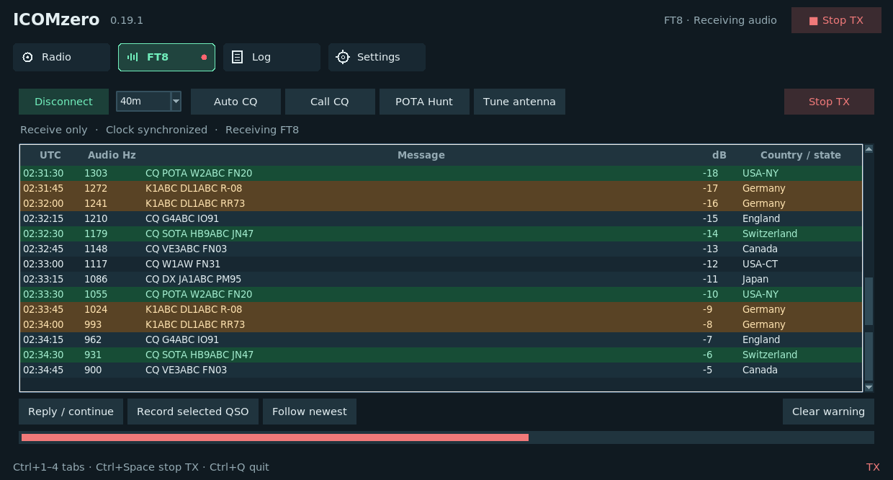

# ICOMzero on uConsole

[Project overview](../README.md) · [Full user guide](USER_GUIDE.md) · [Releases](https://github.com/unagisan69/ICOMzero/releases/latest)

ICOMzero supports the **ClockworkPi uConsole running ARM64 Debian with a graphical desktop**, alongside the original Cardputer Zero build. The desktop frontend shares the same radio protocols, CW decoder, FT8 engine, logbook and settings. The native desktop frontend uses crisp system fonts, resizable tables and a full-width spectrum/waterfall. It does not require the Cardputer LCD or keypad devices.

Four persistent tabs—**Radio, FT8, Log and Settings**—replace the compact launcher. Browse or add contacts, sync the log, or view settings while reception and FT8 sequencing continue in the background. The active session and emergency **Stop TX** remain visible. The rounded FT8 tab carries a red dot while armed or transmitting, even when viewing another tab. Closing the window, quitting from the keyboard or receiving a termination signal cancels RF work and waits for radio logout before exiting. Switching between Radio and FT8 cleanly hands off the radio connection; Log and Settings never own that connection. Connection changes and app installation require disconnecting first; station changes require stopping TX automation.

The port is **keyboard-first**. Trackball clicks and the on-screen navigation buttons are optional. The desktop window works through X11/XWayland; the tested device runs Debian 13, labwc/Wayland and a 1280×720 screen.



*Native uConsole interface shown with synthetic demonstration contacts.*

## Install

Download **`icomzero-desktop_0.18.0-1_arm64.deb`** and **SHA256SUMS** from [GitHub Releases](https://github.com/unagisan69/ICOMzero/releases/latest). On the uConsole, check the package and install it:

```sh
sha256sum --check --ignore-missing SHA256SUMS
sudo apt install ./icomzero-desktop_0.18.0-1_arm64.deb
```

Use the **desktop** package on uConsole. `icomzero_VERSION-1_arm64.deb` is the Cardputer build; the two variants have the same Debian package name and are alternatives, not separate apps installed together.

Open **ICOMzero** from the desktop application menu, or run:

```sh
icomzero
```

For a fullscreen launch:

```sh
icomzero --desktop --fullscreen
```

The package installs its own launcher, icon, Python modules and native FT8 helpers. APT installs the Tk/Pillow/NumPy and ALSA/PipeWire dependencies. Run the app as your normal desktop user, not root. Launch it within the graphical session; a plain SSH shell without access to the desktop display cannot create the window.

## Desktop layout and keyboard controls

| Key | Action |
| --- | --- |
| **Ctrl+1 / 2 / 3 / 4** | Radio / FT8 / Log / Settings |
| **Ctrl+Tab** | Cycle tabs |
| **Tab / Shift+Tab** | Move keyboard focus between controls |
| **↑ / ↓** | Browse tables and lists, select FT8 decodes, or scroll CW history |
| **← / →** | Tune Radio down/up (hold to repeat), except inside text fields |
| **Enter** | Activate the focused button; reply to a selected FT8 decode; clear a visible FT8 warning |
| **Ctrl+Space** | Stop FT8 transmission/automation from any tab |
| **Ctrl+↑ / Ctrl+↓** | Zoom Radio spectrum/waterfall in/out, 1×–8× |
| **Ctrl+← / Ctrl+→** | Radio volume down/up |
| **Ctrl+M** | Mute/unmute Radio audio |
| **Ctrl+Enter** or **F11** | Toggle fullscreen |
| **Ctrl+Q** | Quit with normal receiver/transmitter cleanup |
| **S** | Open Settings from Radio |
| **B** | Focus the band selector in Radio or FT8 |
| **M** | Cycle mode in Radio |
| **W** | CW decoder toggle in Radio |
| **N** | Noise reduction, if supported |
| **T** | Antenna tuner, if supported; **briefly transmits** |

Text fields support normal desktop editing, selection and clipboard paste. Keyboard focus stays in fields while editing, so arrow keys do not accidentally tune the radio. The native window also supports optional trackball clicks and scrolling.

## Settings and existing data

Use **Settings → Radio profiles** to add/select a radio. Use **Settings → Station & FT8** for station identity and **Logging & updates** for Wavelog/QRZ credentials. These are the same settings used by FT8 and Log; all features described in the [user guide](USER_GUIDE.md) remain available.

Data lives in **`~/.config/icomzero/`** (or under `$XDG_CONFIG_HOME`), matching the Cardputer format:

- `radio.json`: named radio connections and app preferences.
- `ft8.json`: station identity, FT8 preferences and provider credentials.
- `qsos.sqlite3`: onboard contacts and durable upload queues.
- `worked.sqlite3`: cached worked-station history.

To migrate from another device, close the app on both devices before copying these files, or use SQLite’s backup API for a consistent database copy. Copy databases rather than only their main file while a live WAL transaction may exist. Preserve mode **0600** on files and **0700** on the private directory. Do not put credentials or private logs in the GitHub repository.

After copying profiles, select the desired connection with **Use this radio**. The log copies then evolve independently; use the configured provider sync to bring later contacts across devices.

## Audio

The desktop build uses the desktop’s default PulseAudio/PipeWire output rather than forcing the Cardputer speaker sink. Select speakers/headphones through the uConsole’s system audio controls. FT8 reception remains intentionally silent; Radio and optional QSO notifications use system playback.

For an explicit ALSA output override:

```sh
icomzero --audio-device pulse
```

`ICOMZERO_AUDIO_DEVICE` is also supported. If you explicitly set `PULSE_SINK`, the desktop build respects it. The default `pulse` device needs `libasound2-plugins`, included in the package dependencies.

## Updates

Use **Settings → Logging & updates → Check for updates**. The desktop updater selects the **icomzero-desktop** asset and verifies SHA-256; the Cardputer updater continues to select its own asset. The desktop installer also checks the package’s platform marker before installation. Settings and logs are preserved. Fully close/reopen the app after an update.

## Build on ARM64 Debian

```sh
sudo apt install build-essential python3-tk python3-pil python3-pil.imagetk python3-numpy fonts-dejavu-core
make check
make test
make package-desktop
sudo apt install ./build/icomzero-desktop_0.18.0-1_arm64.deb
```

The existing `make package APPBUILDER=/path/to/AppBuilder` target still builds the Cardputer package. Desktop packaging does not require AppBuilder or install APPLaunch files.

## Validation and limits

The uConsole port has been checked with native keyboard-driven menu/log navigation and text entry, live Icom receive audio, frequency/scope telemetry, spectrum zoom and disconnect cleanup. DSP/protocol and FT8 waveform checks run in the automated suite. No over-the-air test transmission was needed for the port; entering FT8 normally can start its existing automatic tuner sequence, so use the same antenna/clock/RF precautions as on Cardputer.

Other ARM64 Debian desktop systems may work but have not received the same physical-device validation. The native frontend uses the available display area for additional decode/log rows and native controls.
